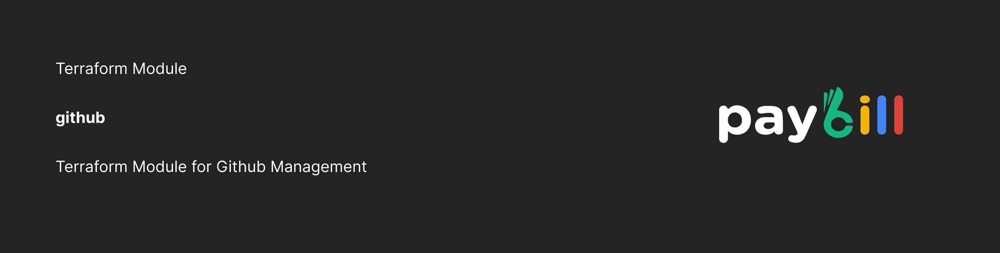

  <a href="https://paybill.dev" target="_blank">
    <picture>
      
    </picture>
  </a>

### Terraform Github Integration Setup

This Terraform module is designed to **fully automate the creation and management of GitHub repositories** with flexible settings. Here’s a brief summary of what it does:

* **Create a repository**: Configures the repository name, description, homepage, topics, visibility (private/public/internal), template usage, and GitHub Pages settings.
* **Initialize defaults**: Optionally creates an initial commit and sets the default branch.
* **Branch protection**: (Commented out in the code) Can enforce rules on the default branch like required reviews, signed commits, status checks, and code owner approvals.
* **Team access management**: Assigns pull, push, or admin permissions to GitHub teams.
* **User access management**: Grants individual users pull, push, or admin permissions.
* **Repository labels**: Creates issue labels with custom names, descriptions, and colors.
* **Merge and branch settings**: Configures allowed merge types (merge, squash, rebase), branch updates, and auto-deletion after merges.
* **Security features**: Optionally enables advanced security, secret scanning, and vulnerability alerts.
* **Outputs**: Exposes repository metadata like ID, Node ID, clone URLs, and full name.

Essentially, it’s a **one-stop module to provision a fully configured GitHub repository** with governance, collaboration, security, and automation baked in.

<!-- BEGIN_TF_DOCS -->
## Requirements

| Name | Version |
|------|---------|
|  [terraform](#requirement\_terraform) | >= 1.3.0 |
|  [github](#requirement\_github) | >= 5.12.0 |

## Providers

| Name | Version |
|------|---------|
|  [github](#provider\_github) | >= 5.12.0 |

## Modules

| Name | Source | Version |
|------|--------|---------|
|  [admin\_teams](#module\_admin\_teams) | ./modules/team-repository | n/a |
|  [admin\_users](#module\_admin\_users) | ./modules/repository-collaborator | n/a |
|  [pull\_teams](#module\_pull\_teams) | ./modules/team-repository | n/a |
|  [pull\_users](#module\_pull\_users) | ./modules/repository-collaborator | n/a |
|  [push\_teams](#module\_push\_teams) | ./modules/team-repository | n/a |
|  [push\_users](#module\_push\_users) | ./modules/repository-collaborator | n/a |

## Resources

| Name | Type |
|------|------|
| [github_branch_default.default](https://registry.terraform.io/providers/integrations/github/latest/docs/resources/branch_default) | resource |
| [github_issue_label.labels](https://registry.terraform.io/providers/integrations/github/latest/docs/resources/issue_label) | resource |
| [github_repository.repo](https://registry.terraform.io/providers/integrations/github/latest/docs/resources/repository) | resource |

## Inputs

| Name | Description | Type | Default | Required |
|------|-------------|------|---------|:--------:|
|  [admin\_teams](#input\_admin\_teams) | A set of team IDs allowed to administer this repository. | `set(string)` | `[]` | no |
|  [admin\_users](#input\_admin\_users) | A set of GitHub users' IDs allowed to admin this repository. | `set(string)` | `[]` | no |
|  [advanced\_security\_enabled](#input\_advanced\_security\_enabled) | Whether or not advanced security features are enabled on the repository. This setting has no effect in public repositories which has this feature enabled by default. | `bool` | `true` | no |
|  [allow\_merge\_commit](#input\_allow\_merge\_commit) | Set to false to disable merge commits on the repository. | `bool` | `true` | no |
|  [allow\_rebase\_merge](#input\_allow\_rebase\_merge) | Set to `false` to disable rebase merges on the repository. | `bool` | `true` | no |
|  [allow\_squash\_merge](#input\_allow\_squash\_merge) | Set to false to disable squash merges on the repository. | `bool` | `true` | no |
|  [allow\_update\_branch](#input\_allow\_update\_branch) | Set to `true` to always suggest updating pull request branches. | `bool` | `true` | no |
|  [archive\_on\_destroy](#input\_archive\_on\_destroy) | Set to `true` to archive the repository instead of deleting on destroy. | `bool` | `true` | no |
|  [archived](#input\_archived) | Specifies if the repository should be archived. | `bool` | `false` | no |
|  [auto\_init](#input\_auto\_init) | Set to `true` to produce an initial commit in the repository. This is required in order to set the default branch on a new repository, but may be set to `false` on imported repositories. | `bool` | `true` | no |
|  [branch\_protection\_enforce\_admins](#input\_branch\_protection\_enforce\_admins) | Setting this to true enforces status checks for repository administrators. In general this should be false to allow admins and service accounts to reconcile branches after a release without creating trailing merge commits -- branches would never be current with one another. | `bool` | `true` | no |
|  [branch\_protection\_required\_status\_checks](#input\_branch\_protection\_required\_status\_checks) | A set of status checks (contexts) that must pass before a branch can be merged into the protected branch. | `set(string)` | `[]` | no |
|  [branch\_protection\_strict](#input\_branch\_protection\_strict) | Setting this to true enforces that a branch be current with the base branch before merging. | `bool` | `true` | no |
|  [default\_branch](#input\_default\_branch) | The name of the default branch for the repository. | `string` | `"main"` | no |
|  [delete\_branch\_on\_merge](#input\_delete\_branch\_on\_merge) | Automatically delete head branch after a pull request is merged. | `bool` | `true` | no |
|  [description](#input\_description) | A description of the repository. | `string` | n/a | yes |
|  [dismiss\_stale\_reviews](#input\_dismiss\_stale\_reviews) | Dismiss approved reviews automatically when a new commit is pushed. | `bool` | `true` | no |
|  [github\_token](#input\_github\_token) | GitHub user/organization that has been generated | `string` | n/a | yes |
|  [github\_user](#input\_github\_user) | GitHub user/organization that will access AWS via OIDC | `string` | n/a | yes |
|  [has\_downloads](#input\_has\_downloads) | Set to `true` to enable the (deprecated) downloads features on the repository. | `bool` | `false` | no |
|  [has\_issues](#input\_has\_issues) | Set to `true` to enable the GitHub Issues features on the repository. | `bool` | `false` | no |
|  [has\_projects](#input\_has\_projects) | Set to `true` to enable the GitHub Projects features on the repository. | `bool` | `false` | no |
|  [has\_wiki](#input\_has\_wiki) | Set to `true` to enable the GitHub Wiki features on the repository. | `bool` | `false` | no |
|  [homepage\_url](#input\_homepage\_url) | URL of a page describing the project. | `string` | `""` | no |
|  [ignore\_vulnerability\_alerts\_during\_read](#input\_ignore\_vulnerability\_alerts\_during\_read) | Set to `true` to omit calling the vulnerability alerts endpoint so the resource can also be used without admin permissions during read. | `bool` | `true` | no |
|  [is\_template](#input\_is\_template) | Whether or not this repository is a template repository. | `bool` | `false` | no |
|  [labels](#input\_labels) | A set of labels to configure for the repository. | <pre>set(object({     name        = string,     description = string,     color       = string   }))</pre> | `[]` | no |
|  [merge\_commit\_message](#input\_merge\_commit\_message) | The default merge commit message. One of `PR_BODY`, `PR_TITLE`, or `BLANK`. | `string` | `"PR_TITLE"` | no |
|  [merge\_commit\_title](#input\_merge\_commit\_title) | The default merge commit title. One of `PR_TITLE` or `MERGE_MESSAGE`. | `string` | `"MERGE_MESSAGE"` | no |
|  [name](#input\_name) | The name of the repository. | `string` | n/a | yes |
|  [pages\_branch](#input\_pages\_branch) | The repository branch used to publish the site's source files. | `string` | `null` | no |
|  [pages\_cname](#input\_pages\_cname) | The custom domain for the repository. This can only be set after the repository has been created. | `string` | `null` | no |
|  [pages\_path](#input\_pages\_path) | The path from which the site publishes GitHub pages. | `string` | `null` | no |
|  [pull\_teams](#input\_pull\_teams) | A set of teams allowed to pull this repository. | `set(string)` | `[]` | no |
|  [pull\_users](#input\_pull\_users) | A set of GitHub users' IDs allowed to read this repository. | `set(string)` | `[]` | no |
|  [push\_teams](#input\_push\_teams) | A set of team IDs allowed to push to this repository. | `set(string)` | `[]` | no |
|  [push\_users](#input\_push\_users) | A set of GitHub users' IDs allowed to write to this repository. | `set(string)` | `[]` | no |
|  [require\_code\_owner\_reviews](#input\_require\_code\_owner\_reviews) | Whether or not an approval is required from code owners to merge a pull request. | `bool` | `true` | no |
|  [require\_signed\_commits](#input\_require\_signed\_commits) | Requires all commits in the branch to be signed with GPG. | `bool` | `true` | no |
|  [required\_approving\_review\_count](#input\_required\_approving\_review\_count) | The number of approvals required to satisfy branch protection requirements. This must be a number between 1 and 6. | `number` | `1` | no |
|  [review\_dismissal\_restrictions](#input\_review\_dismissal\_restrictions) | The list of actor IDs with permission to dismiss reviews. | `set(string)` | `[]` | no |
|  [secret\_scanning\_enabled](#input\_secret\_scanning\_enabled) | Whether or not secret scanning is enabled on the repository. This setting has no effect in public repositories which has this feature enabled by default. | `bool` | `true` | no |
|  [secret\_scanning\_push\_protection\_enabled](#input\_secret\_scanning\_push\_protection\_enabled) | Whether or not secret scanning push protection is enabled on the repository. This setting has no effect in public repositories which has this feature enabled by default. | `bool` | `true` | no |
|  [squash\_merge\_commit\_message](#input\_squash\_merge\_commit\_message) | The default squash merge commit message. One of `PR_BODY`, `COMMIT_MESSAGES`, or `BLANK`. | `string` | `"COMMIT_MESSAGES"` | no |
|  [squash\_merge\_commit\_title](#input\_squash\_merge\_commit\_title) | The default squash merge commit title. One of `PR_TITLE` or `COMMIT_OR_PR_TITLE`. | `string` | `"COMMIT_OR_PR_TITLE"` | no |
|  [template\_owner](#input\_template\_owner) | The owner of the template repository. | `string` | `null` | no |
|  [template\_repository](#input\_template\_repository) | The name of the template repository. | `string` | `null` | no |
|  [topics](#input\_topics) | A list of topics for the repository. | `set(string)` | `[]` | no |
|  [visibility](#input\_visibility) | Determines the visibility of the repository. One of `private`, `public`, or `internal`. Note that `internal` is only available for GitHub Enterprise tiers. | `string` | `"private"` | no |
|  [vulnerability\_alerts](#input\_vulnerability\_alerts) | Whether or not security alerts for vulnerable dependencies are enabled on the repository. | `bool` | `true` | no |

## Outputs

| Name | Description |
|------|-------------|
|  [full\_name](#output\_full\_name) | The full name of the repository in the form `org-name/repo-name`. |
|  [git\_clone\_url](#output\_git\_clone\_url) | The URL that can be provided to `git clone` to clone the repository anonymously via the git protocol. |
|  [http\_clone\_url](#output\_http\_clone\_url) | The URL that can be provided to `git clone` to clone the repository via HTTPS. |
|  [id](#output\_id) | The ID of the repository. |
|  [name](#output\_name) | Name of the repo. |
|  [node\_id](#output\_node\_id) | The Node ID of the repository. |
|  [ssh\_clone\_url](#output\_ssh\_clone\_url) | The URL that can be provided to `git clone` to clone the repository via SSH. |
|  [svn\_url](#output\_svn\_url) | The URL that can be provided to `svn checkout` to check out the repository via GitHub's Subversion protocol emulation. |
<!-- END_TF_DOCS -->