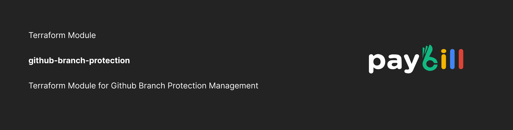

  <a href="https://paybill.dev" target="_blank">
    <picture>
      
    </picture>
  </a>

### Terraform Github Branch Protection Setup

This Terraform module is designed to **create and manage GitHub branch protection rules** for a repository. Its purpose is to enforce workflow policies on branches to ensure code quality, security, and collaboration standards are met. Here's a breakdown of what it does:

### **Core Functionality**

1. **Branch Protection Rule Creation**

   * Applies rules to a branch or a set of branches matching a specified `pattern` (e.g., `main`, `release/*`).
   * Ensures that critical branches are protected from unreviewed or unsafe changes.

2. **Enforce Admins**

   * Optionally enforces branch rules even for repository administrators, preventing bypass of policies.

3. **Status Checks**

   * Requires specific CI/CD checks (`required_status_checks`) to pass before merging.
   * Can enforce that the branch is up-to-date with the base branch before merging (`strict`).

4. **Pull Request Reviews**

   * Configures approval rules for pull requests:

     * Number of required approving reviews.
     * Require approvals from code owners.
     * Optionally dismiss stale approvals when new commits are pushed.
     * Restrict who can dismiss reviews (`review_dismissal_restrictions`).
     * Allow certain actors to bypass review requirements (`pull_request_bypassers`).
     * Require last push approval by someone other than the pusher (`require_last_push_approval`).

5. **Commit Policies**

   * Enforce signed commits (`require_signed_commits`) for security.
   * Optionally enforce a linear Git history (`require_linear_history`) to prevent merge commits.
   * Require all conversation threads in pull requests to be resolved (`require_conversation_resolution`).

6. **Branch Write Permissions**

   * Control whether a branch can be deleted (`allows_deletions`) or force-pushed (`allows_force_pushes`).
   * Optionally lock a branch entirely (`lock_branch`).

### **Variables**

* **Required**: `repository_id`, `pattern`
* **Optional**: dozens of policy and review configuration options, all with sensible defaults.

### **Use Case**

This module is ideal for teams wanting to:

* Protect critical branches like `main` or `release`.
* Enforce structured code review and CI/CD practices.
* Maintain secure and consistent commit histories.
* Minimize human errors or unauthorized changes in production branches.

<!-- BEGIN_TF_DOCS -->
## Requirements

| Name | Version |
|------|---------|
|  [terraform](#requirement\_terraform) | >= 1.3.0 |
|  [github](#requirement\_github) | >= 5.12.0 |

## Providers

| Name | Version |
|------|---------|
|  [github](#provider\_github) | >= 5.12.0 |

## Modules

No modules.

## Resources

| Name | Type |
|------|------|
| [github_branch_protection.branch_protection_rule](https://registry.terraform.io/providers/integrations/github/latest/docs/resources/branch_protection) | resource |

## Inputs

| Name | Description | Type | Default | Required |
|------|-------------|------|---------|:--------:|
|  [allows\_deletions](#input\_allows\_deletions) | Setting this to `true` allows the branch to be deleted. | `bool` | `false` | no |
|  [allows\_force\_pushes](#input\_allows\_force\_pushes) | Setting this to `true` allows the branch to accept for pushes. | `bool` | `true` | no |
|  [dismiss\_stale\_reviews](#input\_dismiss\_stale\_reviews) | Dismiss approved reviews automatically when a new commit is pushed. | `bool` | `true` | no |
|  [enforce\_admins](#input\_enforce\_admins) | Setting this to true enforces status checks for repository administrators. In general this should be false to allow admins and service accounts to reconcile branches after a release without creating trailing merge commits -- branches would never be current with one another. | `bool` | `true` | no |
|  [lock\_branch](#input\_lock\_branch) | Setting this to `true` will make the branch read-only and prevent any pushes to it. | `bool` | `false` | no |
|  [pattern](#input\_pattern) | The pattern identifying branches to which this protection rule will apply. | `string` | n/a | yes |
|  [pull\_request\_bypassers](#input\_pull\_request\_bypassers) | A list of actor names or IDs that are allowed to bypass pull request requirements. Actor names must either begin with a `/` for users or the organization name followed by a `/` for teams. | `set(string)` | `[]` | no |
|  [repository\_id](#input\_repository\_id) | The ID of the repository in which this branch protection rule will be created. | `string` | n/a | yes |
|  [require\_code\_owner\_reviews](#input\_require\_code\_owner\_reviews) | Whether or not an approval is required from code owners to merge a pull request. | `bool` | `true` | no |
|  [require\_conversation\_resolution](#input\_require\_conversation\_resolution) | Setting this to `true` requires all conversations on code must be resolved before a pull request can be merged. | `bool` | `true` | no |
|  [require\_last\_push\_approval](#input\_require\_last\_push\_approval) | Require that the most recent push must be approved by someone other than the last pusher. Defaults to `false`. | `bool` | `false` | no |
|  [require\_linear\_history](#input\_require\_linear\_history) | Setting this to `true` enforces a linear commit Git history, which prevents anyone from pushing merge commits to a branch. | `bool` | `false` | no |
|  [require\_signed\_commits](#input\_require\_signed\_commits) | Requires all commits in the branch to be signed with GPG. | `bool` | `true` | no |
|  [required\_approving\_review\_count](#input\_required\_approving\_review\_count) | The number of approvals required to satisfy branch protection requirements. This must be a number between 1 and 6. | `number` | `1` | no |
|  [required\_status\_checks](#input\_required\_status\_checks) | A list of status checks (contexts) that must pass before a branch can be merged into the protected branch. | `set(string)` | `[]` | no |
|  [review\_dismissal\_restrictions](#input\_review\_dismissal\_restrictions) | The list of actor IDs with dismissal access. | `set(string)` | `[]` | no |
|  [strict](#input\_strict) | Setting this to true enforces that a branch be current with the base branch before merging. | `bool` | `true` | no |

## Outputs

No outputs.
<!-- END_TF_DOCS -->