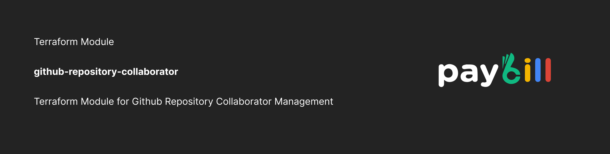

  <a href="https://paybill.dev" target="_blank">
    <picture>
      
    </picture>
  </a>

### Terraform Github Repository Collaborator Setup

This Terraform module is designed to **manage access to a GitHub repository by granting permissions to a specific user**. In other words, it automates adding a collaborator to a GitHub repository with a defined level of access. 

<!-- BEGIN_TF_DOCS -->
## Requirements

| Name | Version |
|------|---------|
|  [terraform](#requirement\_terraform) | >= 1.3.0 |
|  [github](#requirement\_github) | >= 5.12.0 |

## Providers

| Name | Version |
|------|---------|
|  [github](#provider\_github) | >= 5.12.0 |

## Modules

No modules.

## Resources

| Name | Type |
|------|------|
| [github_repository_collaborator.collaborator](https://registry.terraform.io/providers/integrations/github/latest/docs/resources/repository_collaborator) | resource |

## Inputs

| Name | Description | Type | Default | Required |
|------|-------------|------|---------|:--------:|
|  [permission](#input\_permission) | The level of access being granted to the user. One of `pull`, `push`, or `admin`. | `string` | n/a | yes |
|  [repository](#input\_repository) | The name of the repository to which the user is being granted permissions. | `string` | n/a | yes |
|  [username](#input\_username) | The username of the user being granted access to the repository. | `string` | n/a | yes |

## Outputs

No outputs.
<!-- END_TF_DOCS -->