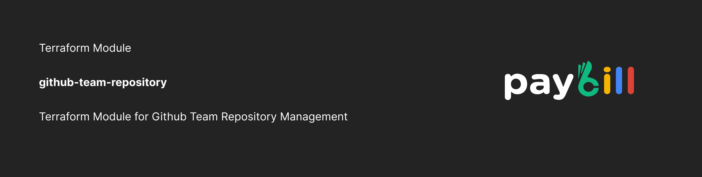

  <a href="https://paybill.dev" target="_blank">
    <picture>
      
    </picture>
  </a>

### Terraform Github Team Repository Setup

This Terraform module is designed to **grant a GitHub team access to a specific repository** with a defined permission level. Here's a clear breakdown of what it does:

### **Purpose**

The module manages **GitHub team repository permissions** by associating a team with a repository and specifying the level of access they should have (`pull`, `push`, or `admin`). It automates access control so you don’t have to manually assign permissions through the GitHub UI.

<!-- BEGIN_TF_DOCS -->
## Requirements

| Name | Version |
|------|---------|
|  [terraform](#requirement\_terraform) | >= 1.3.0 |
|  [github](#requirement\_github) | >= 5.12.0 |

## Providers

| Name | Version |
|------|---------|
|  [github](#provider\_github) | >= 5.12.0 |

## Modules

No modules.

## Resources

| Name | Type |
|------|------|
| [github_team_repository.team_repository](https://registry.terraform.io/providers/integrations/github/latest/docs/resources/team_repository) | resource |

## Inputs

| Name | Description | Type | Default | Required |
|------|-------------|------|---------|:--------:|
|  [permission](#input\_permission) | The level of access being granted to the team. One of `pull`, `push`, or `admin`. | `string` | n/a | yes |
|  [repository](#input\_repository) | The name of the repository to which the team is being granted permissions. | `string` | n/a | yes |
|  [team\_id](#input\_team\_id) | The name or identifier of the team being granted permissions. | `string` | n/a | yes |

## Outputs

No outputs.
<!-- END_TF_DOCS -->